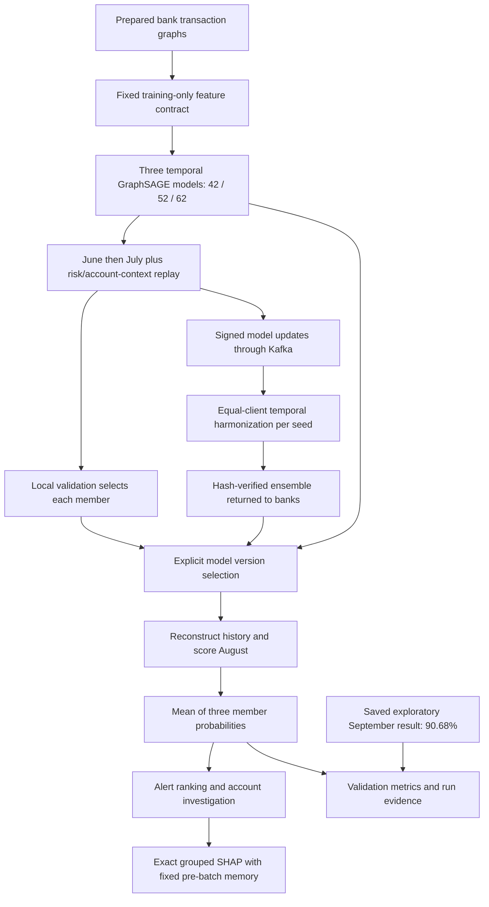

# AML Operations — Federated Continual Learning

A local dashboard for transaction-risk scoring, continual model training, federated collaboration and transaction-level explanations. The application uses three adaptive Temporal GraphSAGE models with GRU account memory and averages their probabilities.

**Recorded final result: 90.68% September bank-macro PR-AUC.** This is one ensemble of seeds 42, 52 and 62 across JPMorgan Chase, Wells Fargo and Key Bank. It is an exploratory result on simulated data, not classification accuracy or a guarantee for newly trained versions. [Saved evidence](artifacts/research_seed_ensemble/exploratory_september/metrics.json).

## Start the dashboard

Use Python 3.10+; Python 3.12 is recommended. From the repository root:

```bash
python -m venv .venv
# macOS / Linux
source .venv/bin/activate
# Windows PowerShell: .\.venv\Scripts\Activate.ps1
python -m pip install -r requirements-dashboard.txt
python -m streaming.app.dashboard
```

Open **http://127.0.0.1:8765**. Local scoring, training and explanations work without Kafka. Keep the terminal open. For another port: `python -m streaming.app.dashboard --port 8766`.

The repository includes the final checkpoints, feature schema and prepared dataset. If any `.csv.gz` file is a Git LFS pointer instead of a gzip file, install Git LFS and run `git lfs pull --include="data/final_temporal_dataset/**"`. Do not replace missing data with synthetic placeholders. Dataset checks report missing or invalid inputs before training.

The existing `Start-Weights-macOS.command`, `Start-Weights-Windows.cmd` and `launch_weights.py` launchers remain available for the transfer workflow and prompt for its shared secret. The direct dashboard command above is simpler for an offline review.

## Use the workspace

| Section | What it does |
|---|---|
| **Overview** | Choose a bank; see the selected model and its evaluation provenance. The final ensemble is selected by default. |
| **Data & training** | Check bank-local training/validation data, adapt all three members with June/July context replay, cancel a job, inspect progress, and explicitly select a completed version. |
| **Transactions** | Score August with the selected ensemble; load, play or step through the replay; jump to the next alert; review all scored transactions; search account or transaction IDs; inspect account connections. |
| **Explanations** | Choose **Explain score** on a transaction. Compute exact grouped SHAP with the same model and pre-batch account memory used for its prediction. |
| **Collaboration** | Configure bank/coordinator roles, check Kafka topics, train across banks, harmonize updates, receive verified ensembles, and select a returned model. |
| **Results & history** | Compare saved baseline and final-ensemble metrics; inspect new validation runs and transfer/federation history; export displayed evidence as JSON. |
| **Weight transfers** | Send or receive an opaque model file using signed chunks, hashes, delivery receipts, cancellation and explicit recovery. |
| **Privacy & transfers** | Inspect implemented controls and missing privacy guarantees. **DP is not implemented in the final model/transfer path.** |

A five-minute demonstration: save **Key Bank** → **Transactions** → **Score validation replay** → **Load replay** → **Next alert** → **Explain score**. Then show **Results & history**, **Privacy & transfers**, and a completed training run.

## Final model and training

| Component | Active implementation |
|---|---|
| Dashboard entry point and local API | [`streaming/app/dashboard.py`](streaming/app/dashboard.py) |
| Interface | [`streaming/web/index.html`](streaming/web/index.html) |
| Unified final model contract | [`streaming/app/final_model.py`](streaming/app/final_model.py) |
| Temporal GraphSAGE, causal memory, feature loading | [`src/gnn/causal_temporal_graphsage.py`](src/gnn/causal_temporal_graphsage.py) |
| Context replay and temporal harmonization | [`src/gnn/adaptive_continual_federated.py`](src/gnn/adaptive_continual_federated.py) |
| Local ensemble adaptation | [`streaming/app/ensemble_training.py`](streaming/app/ensemble_training.py) |
| Model evaluation and replay | [`streaming/app/monitoring.py`](streaming/app/monitoring.py) |
| Explanation worker | [`streaming/app/explanations.py`](streaming/app/explanations.py) |
| Shared preprocessing contract | [`distributed_federation/feature_schema.json`](distributed_federation/feature_schema.json) |
| Federation runtime and aggregation | [`distributed_federation/common/model_runtime.py`](distributed_federation/common/model_runtime.py) |
| Final metric evidence | [`artifacts/research_seed_ensemble/`](artifacts/research_seed_ensemble/) |

The three required model files are:

- [`seed_42/global_model.pt`](artifacts/research_adaptive_fcl/warm_start/federated/context_harmonized/seed_42/global_model.pt)
- [`seed_52/global_model.pt`](artifacts/research_adaptive_fcl/warm_start/federated/context_harmonized/seed_52/global_model.pt)
- [`seed_62/global_model.pt`](artifacts/research_adaptive_fcl/warm_start/federated/context_harmonized/seed_62/global_model.pt)

Their hashes are checked against [`FREEZE.json`](artifacts/research_seed_ensemble/FREEZE.json). The final ensemble needs all three models and separate memory states. The previous single-model dashboard training and sample-weighted federation paths are no longer the dashboard defaults. Earlier CLI configurations remain available for reproducing historical experiments.

**Local adaptation:** each member starts from its final checkpoint, trains three June epochs and three July-plus-context-replay epochs, then competes against its initial checkpoint using August PR-AUC. Each member keeps the better validation checkpoint. The dashboard reports the resulting ensemble's measured validation score. This bank-local adaptation is separate from the original three-bank training study.

**Federated training:** each bank receives all three members and trains them locally with context replay. The coordinator applies equal-client temporal harmonization independently for each seed, saves one safetensors ensemble, and returns it to participating banks. New rounds can improve or worsen performance; returned versions must be evaluated. The workflow does not claim to reproduce 90.68% after arbitrary updates.

## Architecture



Training uses June–July 2025. August 2025 is validation. The dashboard reads the completed September result from disk; it does not silently rerun or tune on September. See the [original ensemble protocol](docs/ENSEMBLE_IMPROVEMENT_RESULTS.md).

## Federated collaboration and transfers

Local review does not require a broker. For collaboration, Kafka must be reachable from every participant. Use the same application version, fixed feature schema, run ID, bank roster, rounds, local epochs, timeout and shared secret on all laptops. Set each laptop's role and local dataset folder, prepare the two collaboration topics on the coordinator, start bank workers, then start the coordinator. The application keeps participant transactions local at runtime; the shared encoder was derived from the public simulated reference training data.

Manual file transfers use a separate topic and `FCL_TRANSFER_SECRET` environment variable (at least 32 characters). Set it privately on both machines or use the existing launcher prompt. Start receiving before sending. **Published** means broker acceptance; **Delivered** means a signed matching receipt; **Verified** means the receiver verified and saved the file. A transferred arbitrary file is not automatically selected or executed.

## Privacy status

**There is no formal differential privacy guarantee in the final implementation.** It has no DP noise mechanism, epsilon/delta accountant or DP release-budget enforcement. Ordinary gradient clipping, HMAC signatures and file hashes do not provide DP. Kafka TLS is not configured by the application; secure aggregation is also absent. The coordinator can inspect individual updates. Transaction explanations are local and are not sent by automatic federation.

See the [privacy audit](docs/PRIVACY_AUDIT.md) for the exact code paths and evidence. Historical XAI reports that mention other privacy experiments do not establish a guarantee for these final checkpoints.

## Verify before the review

```bash
python -m unittest discover -s tests/streaming -v
python -m unittest discover -s tests -v
python -m unittest discover -s xai/tests -v
python scripts/verify_dashboard_workflow.py
# Requires a reachable local Kafka broker:
python -m streaming.test_federation --broker 127.0.0.1:9092 --rounds 1
```

The HTTP acceptance check creates an isolated workspace, verifies all three saved August scores, explains a high-risk transaction, adapts all three models, selects the new ensemble and checks its reloaded score. It does not load September transactions. Runtime state and evidence stay under ignored `streaming/.local/`.

## Documentation

- [Implementation guide](docs/IMPLEMENTATION_GUIDE.md): architecture, data/model mechanics, endpoints, storage, XAI and federation.
- [Codebase reference](docs/CODEBASE_REFERENCE.md): module responsibilities and function/class source map.
- [Final review checklist](docs/FINAL_REVIEW.md): demonstration sequence, verification evidence and operational limits.
- [Privacy audit](docs/PRIVACY_AUDIT.md): DP, integrity, encryption and explanation boundaries.
- [Research progress and prior results](docs/RESEARCH_PROGRESS.md): preserved research README and original architecture details.

This is a simulated-data research application with three banks and two training tasks. September was previously inspected. Cross-laptop connectivity and operating-system setup must be verified on the actual review machines; local tests cannot certify an external network.
